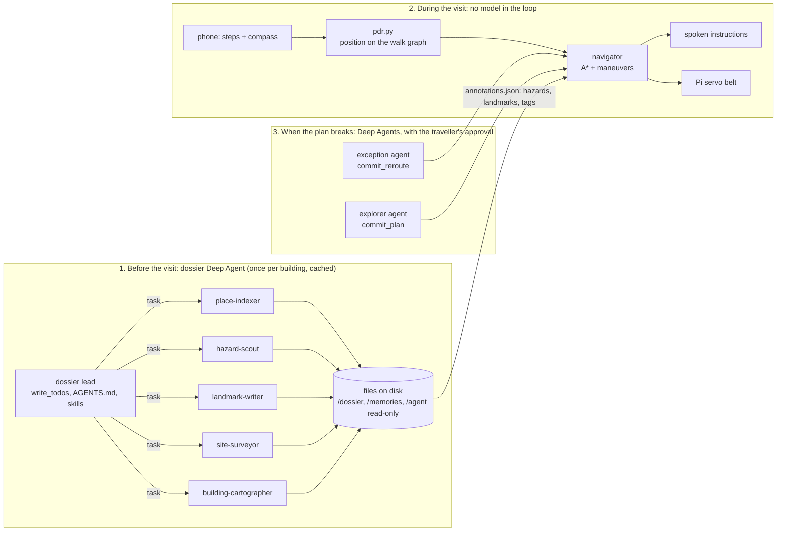

# Isaac

Indoor wayfinding for blind and low-vision visitors, built on CoStar Group's data for the same buildings: Matterport 3D twins, Vexcel aerial imagery and CoStar building records (Houston and Los Angeles).

A traveller carries an iPhone in a back pocket and wears a belt with a Raspberry Pi and two servo pods, one on each hip. The phone counts steps and reads its compass, the Pi keeps the traveller on the building's walk graph, the phone speaks each instruction, and the belt taps the left or right hip at each turn. A caretaker can send trips and watch progress from a second app.

**Thesis: put the AI ahead of the walk, not inside it.** Routing a person through a building is A* on a graph, and left versus right is trigonometry. That part is deterministic, takes milliseconds and can't hallucinate a turn into a stairwell. What the geometry can't tell you is what's dangerous, what can be felt or heard, and where the accessible entrance is. A Deep Agent works that out once per building, before anyone arrives, and caches it. The second visitor pays nothing.

**The demo story** (`nudge/demo.py`): Maya is blind and has an appointment at DJF Insurance, a real current CoStar tenant at 1255 S Atlantic Blvd, Los Angeles, a 1917 Victorian office with no accessibility renovation on record. Her brother Sam follows along on iMessage.

## How it works



### 1. Before the visit: the dossier agent (`nudge/agents/dossier.py`)

The lead plans with `write_todos`, then delegates through `task()` to five subagents:

| Subagent | Job |
|---|---|
| `place-indexer` | Defines what every section of a floor is before anything else: names unnamed rooms, builds the place catalog used for destinations. |
| `hazard-scout` | One floor at a time. The point cloud proposes candidates (protruding objects a cane misses, glass), and `look()` at the panorama confirms or rejects each one. |
| `landmark-writer` | Non-visual landmarks (underfoot, touch, sound, air) at the turn points the route audit flags. |
| `site-surveyor` | The approach from outside, from the Vexcel aerial and the CoStar record: accessible entrance, drop-off, parking, suite directory. |
| `building-cartographer` | Joins a building that is several Matterport scans (lobby, floors, suites). |

The lead merges the results into `/dossier/annotations.json`, validates it, runs a blind and a wheelchair route audit, and re-delegates fixes (two rounds at most). Its identity is in `nudge/agents/AGENTS.md` and its domain knowledge is in six skills under `nudge/agents/skills/`: `hazard-taxonomy`, `nonvisual-landmarks`, `annotation-format`, `site-survey`, `portals` and `place-catalog`. It records lessons across buildings in `/memories/lessons.md`, and a `FilesystemPermission` stops it writing to its own instructions under `/agent/`.

`nudge/agents/finalize.py` is the deterministic end of a run. Smaller models write sloppy JSON or stop before the last write, so it builds `annotations.json` from the subagents' files rather than trusting the lead's final message. A run also keeps a copy of `places.json` and restores it if the lead reshapes or deletes it.

### 2. During the visit: deterministic

- **Position** (`nudge/pdr.py`). The phone sends steps and a compass heading. Steps move the traveller along the route (0.7 m a step by default), not through open space, so step-count error stays along the corridor. The compass only matters when it disagrees with the route for three or more steps: 50 to 135 degrees off means they took another way and the navigator replans from there, and more than 135 degrees means they turned around. Stairs move them a floor after 16 steps on a staircase; an elevator does it after 10 seconds standing in it, then a step out.
- **Graph and routing.** `walkgraph.py` links scan positions that have line of sight through the wall graph, treating doors and openings as passable, and joins floors through stairs and elevators. `router.py` runs A* with accessibility profiles (blind, wheelchair, default).
- **Guidance.** `instruct.py` turns a route into spoken maneuvers, `navigator.py` tracks position, times the cues and reroutes when the traveller drifts, and `device.py` produces metre-and-degree packets for the band.

### 3. When the plan breaks: two more Deep Agents

Both use human-in-the-loop `interrupt_on`, so nothing changes until the traveller approves.

- **Exception agent** (`nudge/agents/exception.py`). For an elevator out, a locked door, a lost traveller. Its tools are `nav_status`, `list_nearby`, `compare_options`, `alternate_goals` and the one acting tool, `commit_reroute`. It reasons only over router output. If the model is unavailable, `server.py` falls back to a deterministic block of whatever the traveller named on the route ahead.
- **Explorer agent** (`nudge/agents/explorer.py`). For when the map runs out: the traveller walked somewhere no scan covers, or the building has no scan or dossier yet. It uses `hazard-scout`, `site-surveyor` and `building-cartographer`. Its one acting tool, `commit_plan`, can only set a destination the router resolves, add a portal that `building.candidates_portals` proposed (marked uncertain until confirmed), or block a pano. It never hands the navigator coordinates.

## The belt (Raspberry Pi, two servos)

The wearable that is built is a belt: a Raspberry Pi, a PCA9685 board and two servo pods, one on each hip, with the traveller's iPhone as the step and heading sensor. [docs/belt.md](docs/belt.md) describes it and how the server hands it a route. The first design was a collar tapping the shoulders, and the driver below was written for it, so its text and `docs/band-pi.md` still say collar and shoulder.

`nudge/band.py` drives two SG90 servos on BCM 12 and 13. Direction is which shoulder taps and magnitude is how many strokes: one light stroke for a slight turn, two for a turn, three on both for arrival or a u-turn, one long press on both when off route. Steering is a single light tap toward the side to turn, at most once every 1.5 s. Cues have ranks (hazard, then state changes, then maneuvers, then steering), so a turn is never lost to a steering tap.

`bandrun.py` connects a navigator to the band, and `bandserve.py` binds one belt to one server session (`NUDGE_BAND=1` attaches it to the first walk that starts, `NUDGE_BAND=dry` wires it up with no GPIO). Wiring, the power warning and the full cue table are in [docs/band-pi.md](docs/band-pi.md).

`firmware/` holds an earlier ESP32 band with vibration motors. It speaks the same line protocol (`nudge/device.py`), but the live demo uses the Pi belt.

## What's in the repo

| Path | What |
|---|---|
| `nudge/` | The Python package: data clients, walk graph, router, navigator, position tracking, band, server, voice, hub. |
| `nudge/agents/` | The three Deep Agents (dossier, exception, explorer), their tools, prompts, skills and the model picker. |
| `ios/` | Two native SwiftUI apps in one Xcode project: **Isaac** (the traveller's, voice only, worn on the back) and **Isaac Care** (the caretaker's). See [ios/README.md](ios/README.md). |
| `mobile/` | An earlier Expo (React Native) traveller app that talks to the same server. |
| `web/` | Browser pages served by the server (below). |
| `firmware/` | The earlier ESP32 vibration-motor band. |
| `reference/` | The track's reference files, including `models_index.csv` (14,945 Matterport models, 41% joined to a CoStar property id). |
| `docs/` | Longer write-ups (index at the bottom). |
| `tests/` | 33 test files. |

### Front ends

| Surface | For | Notes |
|---|---|---|
| **Isaac** (iOS) | Traveller | Waits for a trip, calibrates with a spoken countdown, streams steps and compass to the Pi, speaks every instruction, and takes voice commands ("where am I", "repeat", "how far", "I need help", "stop", "yes" / "no"). |
| **Isaac Care** (iOS) | Caretaker | Pair with the traveller's 6-digit code, send a trip, watch status, a live floor-plan map and a timeline, get a help alert. |
| **iMessage via Photon** (`nudge/photon_bot.py`) | Caretaker | `follow 123456` pairs; then calm status messages per trip and "where are they?" at any time, answered from live state with no model call. A "travel mode" keeps the older traveller commands for testing. |
| **Voice API** (`nudge/voice.py`) | Any voice front end | `POST /api/voice/turn` takes one utterance and returns one short spoken reply. Place lookups, "where am I" and "how far" need no model; anything else during a trip goes to the exception agent. There is also an ElevenLabs tool-definition endpoint. |
| `web/debug.html` | Developers | Floor plan, walk graph, route and a simulated walk with speech. Drag the walker off route to see a reroute, block an edge, and tick **collar** to drive the Pi band from the simulated walk. |
| `web/dossier.html`, `tour.html`, `voice.html`, `companion.html`, `caretaker.html`, `index.html` | Demo and tooling | Dossier agent stream, building tour, browser voice, BLE band companion, the caretaker's iMessage view for the projector, and a landing page. |

### Door to door

Isaac guides from the street to the destination. Outside, the traveller follows a street-level graph where phone GPS works (OpenStreetMap topology, with Vexcel measuring slopes, curb steps and obstacles). At the entrance, guidance hands over to the Matterport scan. See [docs/outdoor.md](docs/outdoor.md). `nudge/handoff.py` and `nudge/georef.py` do the join.

## How the data layers are used

| Layer | What Isaac takes from it |
|---|---|
| Matterport panoramas | `look()` renders a perspective view from any scan position in any model-frame direction. Subagents use it to confirm hazards and to describe floor material, handrails and wall ends. |
| Matterport wall graph + rooms | The walkable graph: line of sight between panos, doors and openings, room labels for destinations and for "into the lobby". |
| Matterport point cloud (MatterPak) | Candidates for protruding objects in the 27-80 in band with nothing below for a cane to hit (ADA 2010 §307.2). Glass suspects are walls with almost no point support. |
| Vexcel | The site survey (entrances, curb ramps, drop-off, accessible parking, the approach from the street) and the outdoor leg (footprint, ground elevation, open-vocabulary detection of crosswalks and obstacles, oblique facade views). |
| CoStar record | Year built (a prior for non-compliant features), floors, tenants and suites as destination aliases, parking. Joined by CoStar property id from `reference/models_index.csv`. |

## Models

The Deep Agents pick a model in this order (`nudge/agents/llm.py`):

1. `anthropic:claude-opus-5-5` if `ANTHROPIC_API_KEY` is set.
2. `google_genai:gemini-3.5-flash-lite` if `GEMINI_API_KEY` (or `GOOGLE_API_KEY`) is set. All agents share one rate limiter so parallel subagents queue instead of tripping the per-minute quota.
3. Otherwise OpenRouter's free router (`OPENROUTER_API_KEY`).

Override with `NUDGE_MODEL` (lead and text agents) and `NUDGE_VISION_MODEL` (subagents that call `look()`; the model must accept images and tool calls). There are no model credits at the hackathon.

## Quickstart

```bash
pip install -r requirements.txt
cp .env.example .env        # keys from /costar-keys in the track Discord; see the table below
python -m pytest -q -p no:anyio
```

The suite needs no keys. Tests that need real data (the CoStar kit, a cached real building, the venue scan) skip themselves: 282 pass and 11 skip on a machine without that data.

No keys needed (synthetic two-floor building):

```bash
python -m nudge.cli synthetic --from K3 --to "Conference Room" --simulate
python -m nudge.cli synthetic --from K3 --to "Conference Room" --simulate --drift-at 10
python -m nudge.band --dry                                          # every collar cue, no GPIO
python -m nudge.bandrun synthetic --to "Conference Room" --dry      # a walk driving the band
python -m uvicorn nudge.server:app --port 8765                      # then http://localhost:8765/debug.html
```

With keys:

```bash
python -m nudge.setkey MATTERPORT_API_KEY MATTERPORT_API_TOKEN VEXCEL_API_KEY   # type secrets without echo
python -m nudge.bringup                    # keys -> probe -> pick -> fetch -> calibrate -> georef -> costar, pass/fail each
python -m nudge.probe                      # Matterport key check + schema questions
python -m nudge.pick                       # rank buildings that join to CoStar and sit under Vexcel coverage
python -m nudge.cli MgGNVWsyXtH --alts     # a real model: graph stats and a route per profile
python -m nudge.agents.dossier <sid>       # run the dossier agent; streams its plan and delegations
python -m nudge.photon_bot                 # iMessage caretaker bot (also serves the API on :8765)
langgraph dev                              # the dossier and exception agents in LangGraph Studio
```

Live demo on the Pi with a phone:

```bash
python -m nudge.pibundle                                  # on the laptop: pack the building data into pi_bundle.tar.gz
python -m nudge.pibundle --unpack pi_bundle.tar.gz        # on the Pi
sudo pigpiod                                              # steadier servo pulses (optional)
NUDGE_BAND=1 python -m uvicorn nudge.server:app --host 0.0.0.0 --port 8765
```

The step-by-step guide (hotspot, addresses, calibration, troubleshooting) is [docs/live-demo.md](docs/live-demo.md). Without a phone, `python -m nudge.pdr --replay walk.jsonl --sid <sid> --to Kitchen` replays a recorded walk.

### Environment variables (`.env`)

| Variable | Used for |
|---|---|
| `MATTERPORT_API_KEY`, `MATTERPORT_API_TOKEN` | Model API (HTTP basic auth). Production host only. |
| `MATTERPORT_SDK_KEY` | The 3D tour pages. |
| `VEXCEL_API_KEY` | Aerial imagery and the outdoor leg. Houston and Los Angeles only. |
| `COSTAR_KIT_URL`, `COSTAR_ZIP_PASSWORD` | The password-protected CoStar data kit. |
| `ANTHROPIC_API_KEY`, `GEMINI_API_KEY`, `OPENROUTER_API_KEY` | One of these for the agents; see Models. |
| `PHOTON_PROJECT_ID`, `PHOTON_API_KEY`, `PHOTON_ALLOWED_SENDERS` | The iMessage bot. Allowed senders is optional. |
| `NUDGE_MODEL`, `NUDGE_VISION_MODEL` | Optional model overrides. |
| `NUDGE_BAND` | `1` attaches the collar to the first walk; `dry` wires it up without GPIO. |

## Track mapping

| Track | Where it shows |
|---|---|
| CoStar "Inside and Out" | **Data:** all three layers for the same address, and each one changes a route or a spoken instruction. **Agentic depth:** the agents plan, delegate, look, validate against the router, audit and re-delegate. **Usefulness:** a blind visitor gets an accessible-entrance briefing and hazard-aware routes in a building they've never been to. **Demo:** the Pi belt, the iOS apps, the debug view. |
| LangChain Deep Agents | **Complex use case:** a multi-floor survey with vision and geometry. **Features used:** `create_deep_agent` in three agents, subagents via `task()`, `TodoListMiddleware`, `CompositeBackend` routing `/dossier`, `/memories` and `/agent` to disk, `memory=["/agent/AGENTS.md"]`, `skills=["/agent/skills/"]`, `FilesystemPermission` read-only on `/agent`, and human-in-the-loop `interrupt_on` on `commit_reroute` and `commit_plan`. `langgraph.json` serves the dossier and exception agents in Studio. |
| Photon | iMessage is the caretaker's channel: pairing by code, calm status messages, and answers to "where are they?" from live state. |
| Amazon Practical AI | A real user and problem, agents that plan and act, adaptive replanning with the traveller's approval, and a caretaker channel the family already has. |
| Best Physical AI | The servo belt: AI-prepared guidance drives hardware that taps the traveller. |

## Limitations

- **Position is dead reckoning.** Steps plus compass, kept on the route. It drifts over distance, the compass swings near steel and elevators, and there is no visual relocalization against the Matterport panoramas. Floor changes are heuristics (16 steps on stairs, 10 seconds in an elevator), and the app can send a floor confirmation.
- **The back-mounted compass has not been checked on a real phone.** The heading maths is unit-tested. Before a demo, wear the phone, face a known direction and compare with a compass app; if it is 180 degrees off, flip the mount setting.
- **Panorama orientation is verified once.** `perceive.FACE1_YAW_DEG` is 0.0, and a by-eye check on one real scan (pano 56 of `MgGNVWsyXtH`) agreed with it. `bringup`'s calibrate step may suggest a 270 degree offset from an image heuristic that is unreliable on real panoramas; compare the four views by eye before changing the constant, because a wrong offset would rotate every hazard bearing.
- **Doorways are derived, not typed.** Real scans type every edge `wall`, so `walkgraph.py` finds doors and openings geometrically. The Model API's `panoLocations.floor` and `room` fields are not available, and `fetch.py` drops a rejected field and retries.
- **Hazard detection is not validated against ground truth.** The point-cloud thresholds were first tuned on synthetic data. The agent confirms each candidate with `look()`, but smaller and free models can still mislabel what they see, which is why `finalize.py` exists.
- **Model providers are the weak point at a hackathon.** The free OpenRouter router can be slow (one real run saw a single call take 23 minutes with retries), and the Gemini trial key rate-limits parallel subagents.
- **Nobody who is blind or low-vision has tested it.** The apps are built for VoiceOver and spoken output, but that has not been confirmed with a screen-reader user.
- **Collar limits.** Servos can render about three cues a second, so cues are dropped rather than queued when positions arrive faster than roughly 300 ms apart. Steering is reduced to a single light tap. Power the servos from their own 5V supply, not the Pi's.
- **iOS Safari has no Web Vibration API**, so the debug view's browser haptics need Android. **Photon Beta iMessage sends text and images only**, and a caretaker must text the line first.

## Docs

| | |
|---|---|
| [docs/architecture.md](docs/architecture.md) | Data contracts and why routing is deterministic. |
| [docs/live-demo.md](docs/live-demo.md) | Running a real walk: Pi, phone, hotspot, calibration, troubleshooting. |
| [docs/belt.md](docs/belt.md) | The belt: what is built and how the server hands it a route. |
| [docs/band-pi.md](docs/band-pi.md) | The earlier servo collar driver: wiring, cue table, why it differs from the ESP32 band. |
| [docs/outdoor.md](docs/outdoor.md) | The street-to-door leg and where each piece of data comes from. |
| [docs/voice.md](docs/voice.md) | The voice endpoint and what the traveller can say. |
| [docs/caretaker.md](docs/caretaker.md) | The iMessage caretaker channel. |
| [docs/bringup.md](docs/bringup.md) | From pasted keys to a working demo. |
| [docs/demo-script.md](docs/demo-script.md) | A timed three-minute demo script. |
| [ios/README.md](ios/README.md) | Building and running the two iOS apps. |
